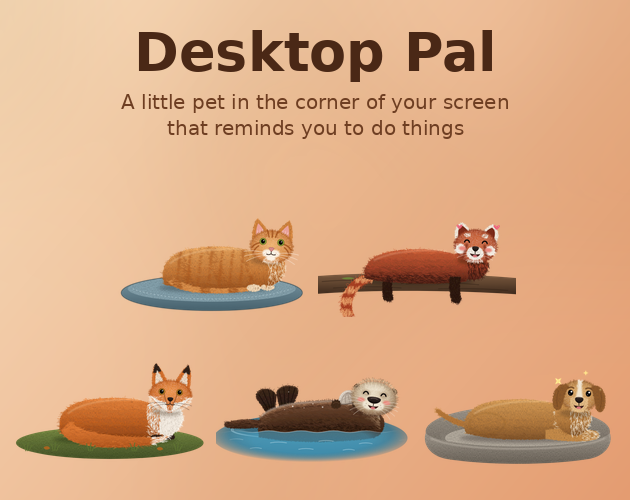
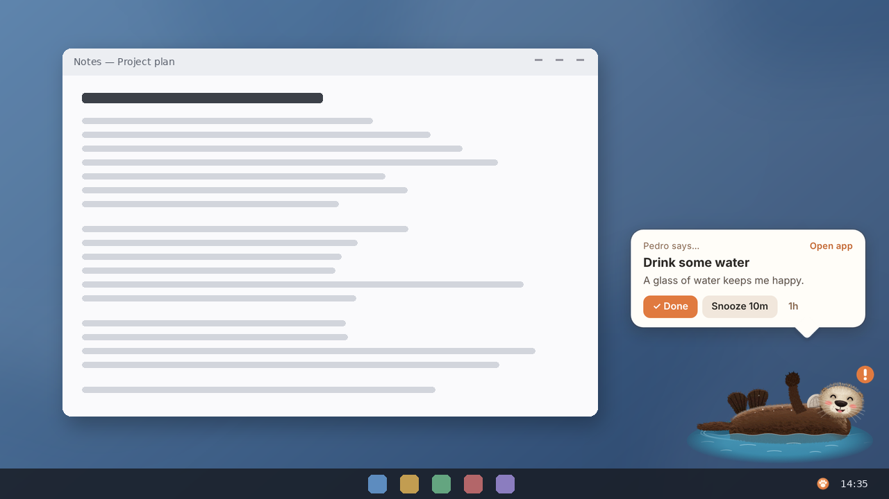
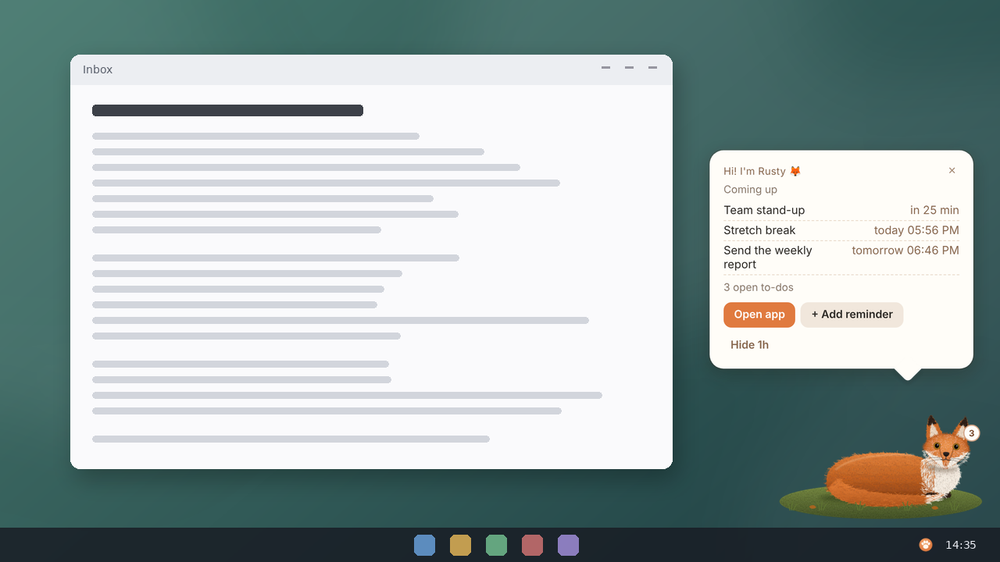
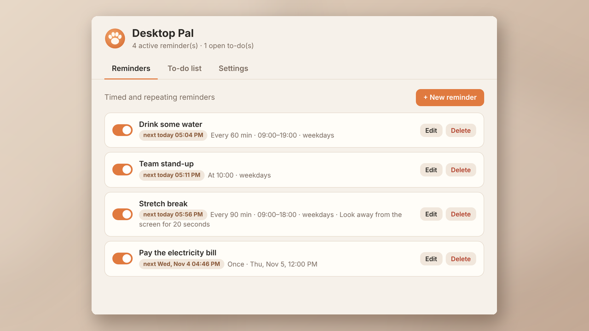

# Desktop Pal

A little animal that lives in the corner of your Windows or Mac screen and reminds you to do things: drink water, take a break, pay that bill, call your mom.



When something is due, your pal wakes up, waves, makes a face that matches the reminder and shows a speech bubble with **Done** and **Snooze**.

| | |
|---|---|
|  |  |

## Download

Get the latest version from the [Releases](../../releases/latest) page.

### Windows

- **DesktopPal-x.y.z-Setup.exe** (recommended): one-click install, no admin needed
- **DesktopPal-x.y.z-Portable.zip**: unzip anywhere and run `Desktop Pal.exe`

Windows may show *"Windows protected your PC"* because the app isn't code-signed. Click **More info → Run anyway**.
Installed copies update themselves: when a new release is published here, your pal tells you and offers **Restart now**.

### Mac

- **DesktopPal-x.y.z-mac-arm64.dmg** for Macs with an Apple chip (M1, M2, M3, M4…)
- **DesktopPal-x.y.z-mac-x64.dmg** for older Macs with an Intel processor

Not sure which? Apple menu → **About This Mac**: "Chip: Apple M…" means arm64, "Processor: Intel" means x64.

1. Open the .dmg and drag **Desktop Pal** into **Applications**.
2. Open it from Applications. The first time, macOS says it can't check the app for malware (it isn't signed with a paid Apple certificate). Click **Done**.
3. Go to **System Settings → Privacy & Security**, scroll down, and click **Open Anyway** next to "Desktop Pal", then confirm.

Your pal lives in the menu bar (the paw icon) and on your screen; there's no Dock icon unless the app window is open.
When a new version is out, your pal tells you and opens the download page; drag the new version into Applications to replace the old one.

## Features

- **Five pets:** sea otter, ginger cat, dog, red fox, red panda (original artwork)
- **Reminders:** once, daily or weekly, every X minutes within set hours (overnight windows work), plus a to-do list
- **Nine facial expressions:** picked automatically from the reminder's wording, or chosen by you
- **Focus timer:** 25/5, 50/10, 90/15 or your own lengths; reminders wait as a badge until your break (or keep showing, your choice)
- **Walks around:** your pet strolls along the bottom of the screen now and then and walks back home (Off / Sometimes / Often)
- **Gaming mode:** when a full-screen game is running, your pet hides and reminders wait until you stop. It peeks in (wearing a headset) to suggest a break every couple of hours, and once at bedtime
- **Petting and treats:** stroke your pet with the mouse; finishing reminders and focus sessions earns treats to feed it
- **Animal voices:** real recordings of a purring cat, a barking dog, a calling fox and a chirping otter (see `src/sounds/CREDITS.md`), with volume control and quiet hours
- **Stays out of the way:** clicks pass through around the pet, drag it anywhere, hide it for a while
- **Light on your PC:** animations run at 10 fps and pause while you're away or the screen is locked
- **Private:** everything stays on your computer, with no account and no data collected



## For developers

```bash
npm install
npm start              # run the app
npm test               # scheduler unit tests (set TZ=Europe/Sofia for the clock-change cases)
npm run test:e2e       # end-to-end tests (needs a display, e.g. xvfb-run)
# native/gamecheck.exe: x86_64-w64-mingw32-gcc -O2 -s -municode -mwindows native/gamecheck.c -o native/gamecheck.exe -lshell32
npm run build:art      # regenerate src/pet.html and src/pets/*.json from tools/ (Python + matplotlib)
npm run dist           # build the Windows installer into dist/ (the Mac apps are built on GitHub's Mac machines)
```

**Releasing:** bump `version` in `package.json`, commit, then on GitHub go to **Actions → Build & release → Run workflow**.
A Windows machine builds the installer and a Mac builds the Mac apps; both are published in one release. Installed copies pick it up automatically.

### Project layout

| Path | What it is |
|---|---|
| `src/main.js` | App process: windows, tray, scheduler, updater |
| `src/pet.html` | The pet window (bubble, expressions, motion engine) |
| `src/pets/*.json` | Artwork for each animal, loaded on demand |
| `src/manager.html` | The reminders/settings window |
| `src/sounds/` | Animal voice clips and their credits |
| `native/gamecheck.c`, `native/gamecheck.swift` | Tiny Windows / Mac helpers that tell the app when a full-screen game is in front |
| `tools/` | Art generator, screenshot scripts, tests, performance tools |
| `.github/workflows/release.yml` | Builds and publishes releases |

## License

MIT. See [LICENSE](LICENSE). Built with [Electron](https://www.electronjs.org/).
This project, including its artwork, was made with the help of Claude, an AI assistant.
